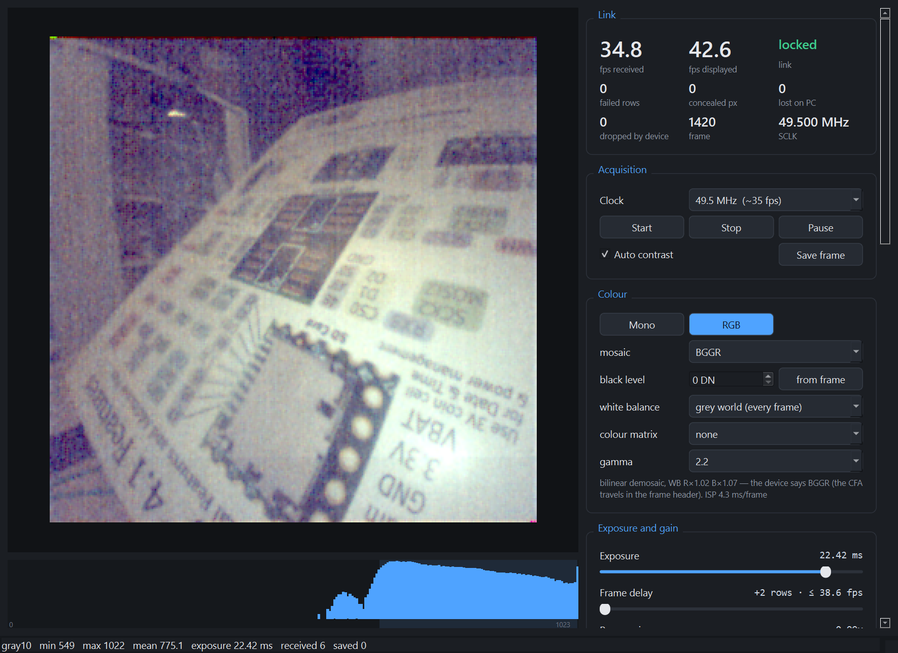

# Getting started

From an empty desk to images on screen. Allow about an hour, most of it wiring and some
of it looking for the jumper wire that rolled under the desk. Everything
here has been done on Windows 11. The Python side should work anywhere, but that is untested.

## 1. What you need

| Item | Notes |
|---|---|
| ams **NanoBerry** board with a NanEyeC fitted | The sensor is part `S1`. The board has a 40-pin Raspberry Pi header (`J2`), which is what we wire to |
| **Teensy 4.1** | PJRC. Its I/O is 3.3 V and **not 5 V tolerant**, which suits the NanoBerry |
| USB cable | micro-USB, data-capable. It powers both the Teensy and the camera |
| Breadboard and jumper wires | Female-to-male or male-to-male, depending on how you seat the NanoBerry. **Keep the clock and data wires short** (see [Hardware](hardware.md)) |
| A PC with [uv](https://docs.astral.sh/uv/) and git | uv installs the right Python and every dependency, including the firmware toolchain |
| *Optional:* a 100 Ω resistor | In series with Teensy pin 26. Recommended protection, [explained here](hardware.md#recommended-a-series-resistor-on-pin-26) |
| *Optional:* Saleae Logic analyser | Only for development and debugging. The camera does not need it |

## 2. Wire it

Power off (USB unplugged) while wiring. Teensy pin numbers are the ones printed on the
board; `J2.n` is pin *n* of the NanoBerry's Raspberry Pi header.

| Teensy 4.1 | NanoBerry J2 | Signal |
|---|---|---|
| pin 27 | J2.23 | **SCLK**, the clock to the sensor |
| pin 26 **and** pin 1, joined | J2.19 | **SDAT**, data in both directions (why two pins: [here](hardware.md#why-sdat-goes-to-two-pins)) |
| pin 2 | J2.33 | **NanEye_EN**, switches the sensor's power on |
| VUSB | J2.2 or J2.4 | 5 V supply for the board |
| GND | J2.6, 14, 20 or 25 | ground; use more than one |

For the LEDs on the NanoBerry (optional, not yet tested): pin 3 → J2.31, pins 4 / 5 / 6 →
J2.36 / 38 / 40, and J2.9 to ground.

!!! warning "Three things that matter"
    - **Pins 26 and 1 both go to J2.19.** The Teensy transmits on 26 and receives on 1.
    - **Nothing that drives a signal on the NanoBerry's other connectors (`J1`, `P1`).**
      They share the sensor's data lines, so anything driving them interferes. A
      logic-analyser probe is fine.
    - **Short wires, with a ground wire close to SCLK and SDAT.** The link runs at 12–25 MHz,
      where long loose wires start to corrupt data.

The [photo on the hardware page](hardware.md#the-bench-in-the-photo) shows a working layout.

## 3. Get the code and flash the Teensy

```bash
git clone https://github.com/phili-b/teensy_naneyeC.git
cd teensy_naneyeC
uv sync                                                        # Python environment
uv run --group firmware python -m platformio run -d firmware -t upload
```

The first `upload` downloads the Teensy toolchain, which takes a few minutes. If it reports
`error writing to Teensy`, run it again; the first attempt after a reboot often fails. By
now it is practically a tradition. If
it keeps failing, press the white button on the Teensy once and retry.

## 4. Check the Teensy

```bash
uv run python tools/device_check.py
```

Expected output, roughly:

```
port COM11
ID        -> naneye-teensy 0.1.0  sclk=12375000 Hz ...  fmt=1  last reset: normal ...
SELFTEST  -> SELFTEST unpack: bad_words=0 mismatches=0 training=8/8 -> PASS
SELFTEST  -> SELFTEST exposure: ... -> PASS
STATS     -> STATS frames=0 sent=0 dropped=0 streaming=0 powered=0 ...
all checks passed
```

`SELFTEST` decodes a real row of sensor data stored in the firmware. It checks the Teensy's
decoding, not the wiring, so it passes even with no camera attached. `last reset:
WATCHDOG` straight after flashing is normal.

## 5. See an image

```bash
uv run python -m naneye.gui
```

This finds the Teensy, opens the camera window, then powers the sensor and starts it at
49.5 MHz, about 35 frames per second. The clock can be changed in the window. Starting
takes about a second, because the sensor is powered off for 1 s first to guarantee a clean
reset.



The **Link** panel is the one to watch. *fps received* is what arrives over USB intact;
*fps displayed* is what the window paints. *Failed rows*, *concealed px*, *lost on PC* and
*dropped by device* should all stay at 0. The panels below have sliders for exposure,
frame delay, gain and the analog settings, a decoded table of the sensor's registers, and
the device's replies. [Host software](host.md#camera-gui) explains every part.

| Key | Action |
|---|---|
| ++plus++ / ++minus++ | longer / shorter exposure |
| ++r++ | datasheet-recommended analog settings |
| ++l++ | LED on/off (the *Illumination* panel sets the current) |
| ++s++ | save the frame (16-bit PNG, raw 10-bit values) |
| ++space++ | pause |
| ++q++ | quit |

**No camera yet?** `--source replay` plays back real frames from the reference capture, or
synthetic ones if you do not have it, through exactly the same code path.

## 6. Record

```bash
uv run python -m naneye.record --source auto --frames 200 --out capture/run1
```

This writes `frames.npy` (all frames, 10-bit values in `uint16`), `meta.csv` (one line per
frame: timestamp, exposure, error counters…) and `run.json` (settings and a summary). The
[host page](host.md#recorder) shows how to load and check them.

## 7. Talk to it from Python

The firmware takes plain-text commands such as `EXP 80` or `STATS`; the
[command list](host.md#commands) has all of them. From Python:

```python
from naneye.transport import Device

with Device.open_first() as dev:
    print(dev.ask("ID"))
    print(dev.ask("CLK 49500000"))
    print(dev.ask("START"))          # powers and starts the sensor
    print(dev.ask("EXP 80"))         # shorter exposure
    for pkt in dev.frames():         # image packets, each with its own header
        print(pkt.header.describe())
        break
    dev.ask("STOP")
```

Only one program can hold the serial port at a time. Close the viewer before running a
script, and the other way round.

## When it does not work

| Symptom | Likely cause |
|---|---|
| `no Teensy serial port found` | Firmware not flashed, or a charge-only USB cable |
| `could not open port … Access is denied` | Another program (the viewer, a serial monitor, Arduino IDE) has the port open |
| `START failed: pre-sync training pattern 0/328 … No sensor answering` | The sensor is not powered or not connected: check pin 2 → J2.33, 5 V and ground, and that SDAT goes to J2.19 |
| `START failed: sensor answers … but could not lock onto its rows` | The sensor answers but its data arrives damaged at every sampling point the Teensy can choose; the `START sampling:` line shows how each fared. Try `--clock 24750000`, shorten the SDAT wire, add a ground next to it |
| `concealed` above 0 while streaming | Some pixel words arrived with broken framing and were replaced by their neighbours' mean. Occasional ones are harmless; a steady stream means the link is marginal: same remedies |
| `rows_failed` above 0 while streaming | Intermittent signal-integrity problem, same remedies. Frames with failed rows are flagged, not hidden |
| Image very dark or all white | Exposure. Press ++minus++ / ++plus++, or send `EXP 0` (longest) … `EXP 159` (shortest). Or something is in front of a 1 mm² lens, which takes remarkably little; it happened while these docs were being written |
| Lots of `dropped` frames | The PC is not reading fast enough: close other programs, or record rather than view |

Beyond that, [Hardware and bring-up](hardware.md#bring-up) has the full staged procedure and
the diagnostic commands that found every fault so far.
